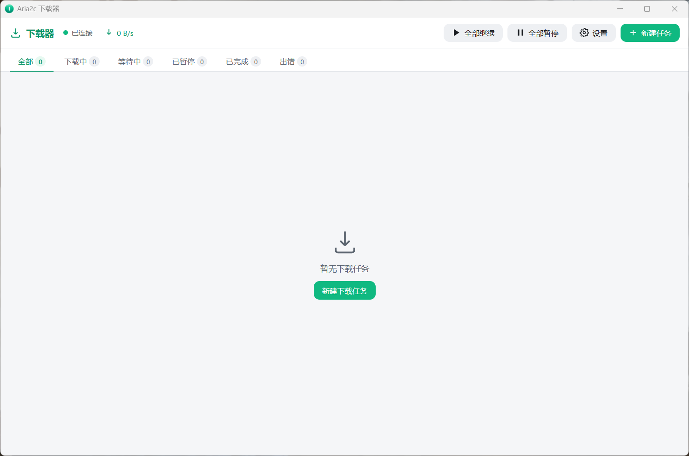
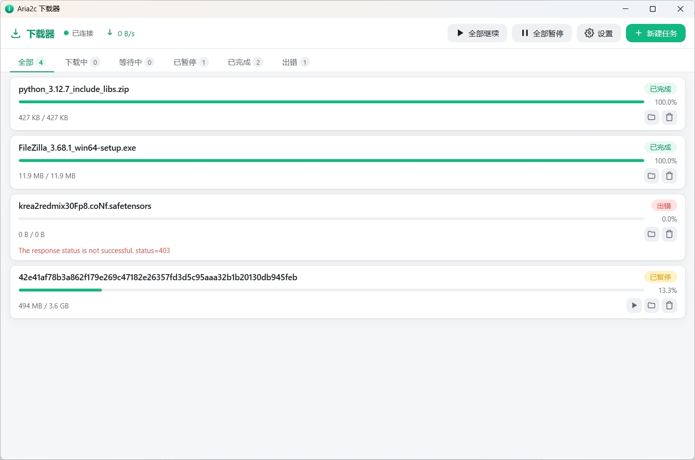
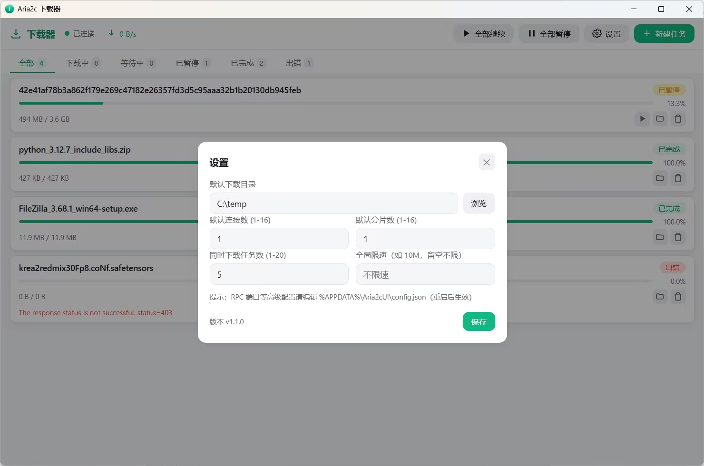

<div align="center">

# Aria2c UI

A lightweight Windows desktop downloader powered by [aria2](https://github.com/aria2/aria2)

*Multi-threaded · Resumable · Magnet/BT · Portable*

[](LICENSE.txt)
[](https://github.com/wudidiandian/aria2c-ui/releases)
[](https://www.python.org/)
[](https://github.com/wudidiandian/aria2c-ui/releases)

English | [简体中文](README.md)

</div>

---

Aria2c UI is a desktop download client built on [aria2c](https://github.com/aria2/aria2): a pywebview window + native web frontend + bundled aria2c engine. **A single 18 MB file, runs out of the box, fully offline UI, and all data lives in the user profile directory.**

## Screenshots



| New task | Settings |
|---|---|
|  |  |

## Features

- **HTTP(S) downloads**: paste multiple links (one task per line); per-task connection count (-x), split count (-s), and speed limit
- **BitTorrent / magnet links**: supports `magnet:?xt=urn:btih:...` and .torrent files with automatic metadata fetch and task naming
- **BT file selection**: pick which files to download from multi-file torrents (at creation, editable per task); unselected files take no disk space
- **Seeding management**: configurable seed ratio/time, DHT, extra trackers; task cards show seeders and share ratio
- **Resumable downloads**: progress is written to the session file in real time; downloads resume after restarting the app or the computer
- **Task history**: completed tasks survive restarts (aria2 itself does not persist them; this app stores history locally)
- **Live progress**: backend state push, second-level refresh, no flickering
- **Task management**: pause/resume/remove (including batch), filter by status, open file location
- **Global settings**: concurrent task count, default connections/splits, global speed limit — applied immediately on save
- **Process safety**: kernel-level Job Object binding ensures the aria2c engine never becomes an orphan process no matter how the host exits; automatic engine restart on crash
- **Delete means deleted**: removed tasks are permanently cleared (tombstone mechanism) and never come back after restart

## Installation

### Portable (recommended)

1. Download `Aria2cUI.exe` from the [latest release](https://github.com/wudidiandian/aria2c-ui/releases/latest)
2. Double-click to run — no installation needed

> Requirements: Windows 10/11 with WebView2 Runtime (built into Win11; Win10 will prompt to install it on first launch if missing)

### System dependencies

**None.** Python, aria2c, and all libraries are bundled inside the exe — end users need nothing installed.

## Running from source

```bash
# 1. Install dependencies (Python 3.10+)
pip install -r requirements.txt

# 2. Download aria2c (if not already in the repo)
#    Get the win-64bit build from https://github.com/aria2/aria2/releases
#    Put aria2c.exe into the aria2c/ directory

# 3. Run in development mode
python build.py dev
```

## Packaging

```bash
pip install -r requirements-dev.txt   # includes PyInstaller

python build.py onefile   # single-file build (recommended for distribution)
python build.py build     # directory build (faster startup)
python build.py installer # Inno Setup installer (requires Inno Setup 6)

python build.py clean     # clean build artifacts
```

Custom icon: place a 1024x1024 transparent PNG at `assets/icon-source.png` and run `python create_icon.py` to generate a full-size-set ico.

See [BUILD_GUIDE.md](BUILD_GUIDE.md) for details (Chinese).

## Data storage

All user data lives in `%APPDATA%\Aria2cUI`, decoupled from the program directory:

```
%APPDATA%\Aria2cUI
├── aria2.session    # unfinished tasks + resumable bitfield (managed by aria2)
├── history.json     # completed/failed task history + deletion tombstones
├── config.json      # settings
├── downloads/       # default download directory
└── logs/            # runtime logs
```

Deleting the exe does not delete your data; manually removing this directory resets everything. Copying the whole directory (including `downloads/`) to another computer preserves the task list and resume points.

## Architecture

```
┌─────────────────────────────────────────┐
│           pywebview window (WebView2)   │
│  ┌───────────────────────────────────┐  │
│  │  Frontend (HTML/CSS/vanilla JS)   │
│  │  window.pywebview.api  ←→  Python │  ← single channel
│  └───────────────────────────────────┘  │
│  Push thread: poll aria2 → evaluate_js  │
└───────────────┬─────────────────────────┘
                │ JSON-RPC (127.0.0.1)
┌───────────────▼─────────────────────────┐
│  aria2c subprocess (Job Object + graceful shutdown) │
└─────────────────────────────────────────┘
```

- **Single channel**: the frontend calls Python methods directly through the `pywebview js_api` bridge — no local HTTP server, no CORS exposure
- **Backend push**: a Python thread polls the aria2c RPC (2s idle / 1s active) and pushes changes to the frontend via `evaluate_js`
- **Graceful shutdown**: `aria2.shutdown` is called on exit to save the session; a Job Object guarantees the engine is reclaimed by the OS even if the host process dies
- **Crash isolation**: an aria2c crash does not take down the UI — the engine is restarted automatically (up to 3 times)

### Project layout

```
aria2c-ui/
├── aria2c/                 # bundled aria2c binary (see aria2c/VERSION.txt for version)
├── src/
│   ├── backend/            # Python backend
│   │   ├── main.py         # entry: pywebview window + js_api + push thread
│   │   ├── aria2_client.py # aria2 RPC client (typed errors, idempotent ops)
│   │   ├── aria2_process.py# process management (Job Object / health check / auto-restart)
│   │   ├── config.py       # configuration (%APPDATA%\Aria2cUI)
│   │   ├── history.py      # task history + deletion tombstones
│   │   └── models.py       # Pydantic models
│   └── frontend/           # web frontend (zero dependencies, offline)
├── assets/                 # icon source and .ico
├── build.py                # build script
├── create_icon.py          # icon generation (supports hi-res source)
└── setup.iss               # Inno Setup script
```

## Roadmap

- [x] Windows single-file portable build
- [x] BT enhancements: torrent files, seeding management
- [x] Selective file download for multi-file torrents
- [ ] Browser integration (extension to capture downloads)
- [ ] i18n / localization
- [ ] Linux / macOS support (platform-specific engine binaries and process management; architecture ready)
- [ ] Download queue ordering and batch editing

Platform note: only Windows builds are provided for now. Core modules (`aria2_client`, `history`, `config`) are already cross-platform; the main work for Linux/macOS is process management in `aria2_process` and engine distribution. PRs welcome!

## Contributing

Issues and PRs are welcome! Please read [CONTRIBUTING.en.md](CONTRIBUTING.en.md).

## License

This project's code is released under the [MIT License](LICENSE.txt).

This project redistributes the unmodified [aria2](https://github.com/aria2/aria2) binary (GPL-2.0-or-later, with an OpenSSL linking exception) as a separate process communicating via JSON-RPC — this constitutes mere aggregation, not code linking. See [THIRD-PARTY-LICENSES.md](THIRD-PARTY-LICENSES.md) for all third-party licenses.

## Acknowledgements

- [aria2](https://github.com/aria2/aria2) — the powerful command-line download engine
- [pywebview](https://github.com/r0x0r/pywebview) — lightweight desktop WebView container
- All library authors (see THIRD-PARTY-LICENSES.md)
